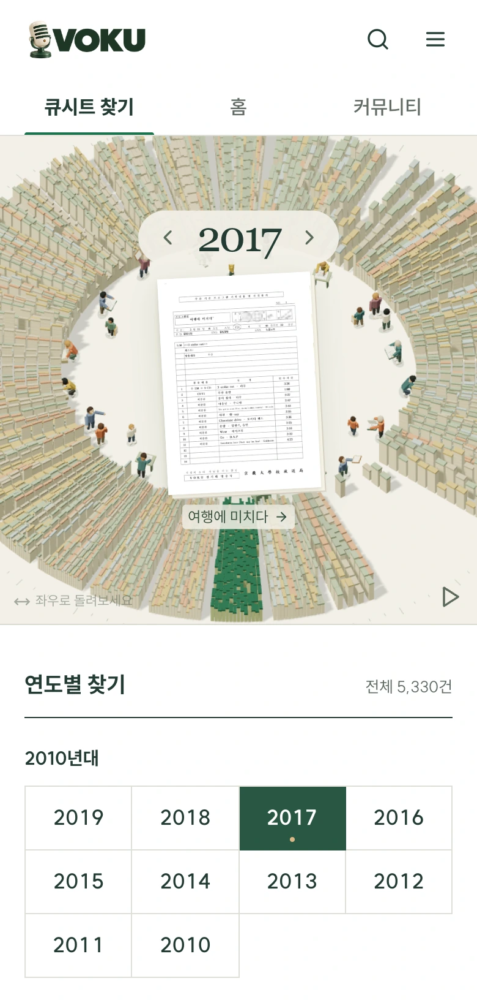
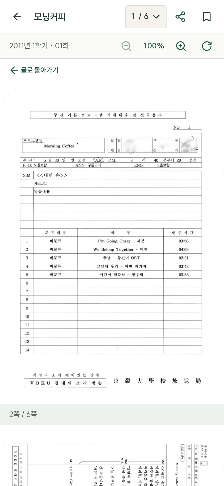
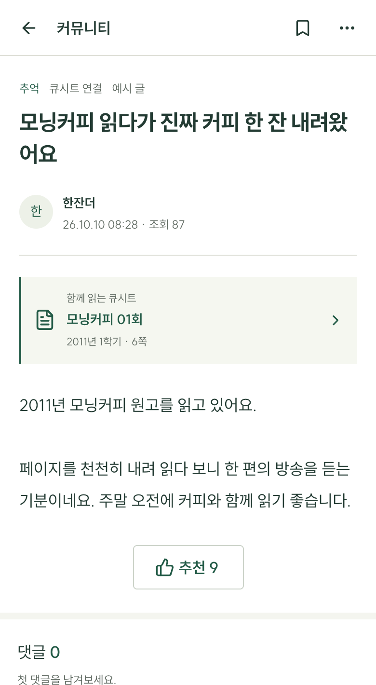
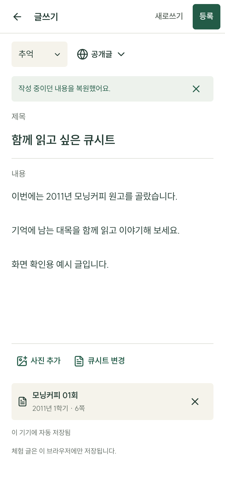

# VOKU On

**A mobile archive reader and community for VOKU alumni.**

VOKU is a university student broadcasting station whose cue-sheet archive spans **32 years (1988–2019)**. The prepared public archive contains **66,010 pages** of broadcast cue sheets (큐시트). VOKU On gives alumni a place to find the years they remember, read on a phone, and share a story when they want to.

I built it around occasional visits: find something familiar, read it, perhaps join a conversation, and leave. It is an independently designed, built, and operated personal project. The interface is in Korean.

<p align="center">
  
</p>

*Choose a remembered year from the ring or the list. Local demo using prepared public archive material.*

[Open VOKU On](https://voku.pages.dev/) · [Design decisions](#design-decisions) · [Run locally](#run-locally) · [Related projects](#related-projects)

## Design decisions

### Keep the direct route and the visual character

The archive follows **year → semester → program → episode (회차) → page**. A familiar year is a useful starting point for someone returning after a long absence.

The year directory stayed when the time ring was added. Choosing a year in the ring also highlights it in the directory, as shown above. The list provides a direct route, while the ring gives the archive a visual identity. Simple operation does not require removing that character.

### Give reading its own space

Inside an episode, pages form one continuous vertical view. Page navigation, zoom, rotation, and device-local reading progress support the document rather than surrounding it with a conversation feed.

<p align="center">
  
</p>

*Continue into the next page without opening another viewer. Prepared public archive pages are displayed in the local demo.*

Comments belong to community posts. A post can link to an archive episode, and the reader provides a route back to that post. Reading can also be the whole visit; there is no requirement to post afterward.

<p align="center">
  
</p>

*Open the attached episode, then return to the conversation. The post, nickname, and activity counts are sample data in the local demo.*

### Simplify writing while keeping the work

The writing screen centers on a title, plain-text body, and optional photos or a cue sheet. Formatting tools and full-post preview were removed; local draft protection and the route back to the originating list were kept.

<p align="center">
  
</p>

*Return to a saved draft with its text and linked episode intact. This sample draft was restored after a browser reload; it was not published.*

The [community experience notes](docs/community-ux.md) explain the editor and preservation of list filters and position. The [navigation code](src/community/navigation.ts) carries that context through posts, reading, and writing. These behaviors matter even when the screen itself becomes simpler.

## How it was built

I started with mobile archive prototypes, then used them to settle the constraints: direct year selection, continuous reading, and a separate space for conversation. AI coding agents implemented and revised the app within those constraints. Review combined automated navigation and source-preservation checks with browser walkthroughs at narrow screen widths. For example, simplifying the editor removed formatting and preview controls while checks continued to cover draft recovery and return to the original list. The [editor implementation and verification notes](docs/community-ux.md#2026-10-11-글쓰기-화면-전면-개편) record that change and its checks.

## Related projects

| Project | Responsibility |
| --- | --- |
| [VOKU Archive dataset](https://huggingface.co/datasets/NewTypeCola/VOKU-Archive) | The prepared corpus: cue-sheet images, OCR, and token annotations. |
| [VOKU Archive Workflow](https://github.com/NewTypeCola/VOKU-Archive-Workflow) | Workflow, History, a three-episode execution demo, and a review web app documenting archive preparation. |
| **VOKU On — this repository** | Archive browsing, continuous reading, and the alumni community. |
| [VOKU On Operations](https://github.com/NewTypeCola/VOKU-On-Operations) | Separate operations access, moderation, and aggregate usage reporting. |

Collection, scanning, redaction, pseudonym tokens, and review belong to **VOKU Archive Workflow**. Its review web app is a processing-review tool, not this alumni reader.

## Run locally

Use **Node.js 24.13.0**, as specified in `.node-version`.

```sh
git clone https://github.com/NewTypeCola/VOKU-On.git
cd VOKU-On
npm ci
npm run dev
```

Open the URL printed by Vite. The default address is `http://127.0.0.1:5214/`.

Without Supabase configuration, community features use a browser-local demo. Demo accounts and posts are samples, and connecting a backend does not automatically upload them. Reading archive pages that are not cached in the repository still requires a network connection.

The layout remains phone-oriented on desktop, with a maximum width of 480px and top-level navigation rather than a bottom navigation bar.

### Connect a community backend

```sh
cp .env.example .env.local
```

Set `VITE_SUPABASE_URL` and `VITE_SUPABASE_PUBLISHABLE_KEY` for your own project. Follow the [authentication setup guide](docs/auth-setup.md) for provider configuration, callback URLs, email delivery, and feature flags. Enable a provider only after completing its setup.

The community interface provides Kakao and email authentication when configured. Google authentication code and configuration remain in the project, but its community sign-in button is currently hidden.

Community schema, storage policies, and access rules live in `supabase/migrations/`. Operations and usage-reporting migrations live in `VOKU-On-Operations`. Both apps share a database; check the applied migration history before making changes. A frontend build does not apply database migrations.

Only browser-safe configuration belongs in `VITE_*` variables. Service-role keys, database passwords, SMTP credentials, and other private credentials must stay outside the frontend bundle.

## Archive source

The catalog covers **1988–2019**, with **5,330 document records and 66,010 pages**, using the [prepared VOKU Archive edition at revision `946efb6`](https://huggingface.co/datasets/NewTypeCola/VOKU-Archive/blob/946efb631be114cbbc410fa4bceeed4df0559010/README.md).

A small sample is cached in the repository. Other pages load through the public Hugging Face Dataset Viewer. Rotation changes the display without rewriting dataset images. Data checks verify catalog counts, page order, and cached image hashes.

The reader presents cue-sheet images; it does not provide OCR reading, full-text OCR search, or OCR export. OCR and token annotations are available in the dataset. Preparation limits and reuse conditions are documented in Workflow and the [archive rights and credits](public/licenses/VOKU-Archive-rights.md).

## Accounts, privacy, and usage

Community board administrators (게시판 관리자) and dashboard operators have separate permissions. Database policies and server functions enforce access to content and member information.

The optional **enrollment year (학번)** is a year, not a full student identification number. **Membership cohort (기수)** is the member's cohort within VOKU. These are not public profile fields; access is limited to the account holder and authorized staff. Reading progress and drafts use browser storage.

Production usage reporting runs through Cloudflare Pages Functions. IP addresses are processed into daily keyed hashes for rate limiting; application usage records do not retain raw IP addresses. Browser counts are not verified counts of people. The [privacy and usage controls](https://voku.pages.dev/privacy/) explain collection, retention, opting out, and erasing retained details for the current browser.

This description applies to `main`. The separate [`codex/voku-ux-study` branch](https://github.com/NewTypeCola/VOKU-On/tree/codex/voku-ux-study) runs a UX experiment on a separate deployment. It automatically records interactions and stores each visit's last connection IP in a separate database. Its [experiment documentation](https://github.com/NewTypeCola/VOKU-On/blob/codex/voku-ux-study/docs/ux-study-auto-verification.md) describes that collection behavior, access rules, and verification; the privacy description above does not apply to that experiment.

## Check, build, and deploy

```sh
npm test
npm run check
npm run build
npm run preview
```

The app uses **React, TypeScript, Vite, HeroUI, and Supabase**, with **Three.js** for the time ring. Tests include isolated database checks alongside navigation, reader, community, and collection checks. The commands above are for local verification; recorded implementation checks are described in the linked project documents.

| Cloudflare Pages setting | Value |
| --- | --- |
| Production branch | `main` |
| Build command | `npm ci && npm test && npm run check && npm run build` |
| Output directory | `dist` |
| Node.js version | `24.13.0` |

`npm run preview` serves the built frontend and uses the same port as the development server; do not run both at once. Cloudflare Pages Functions under `functions/` and database migrations require separate configuration. On another domain, review authentication redirects and collector origin rules. The usage ingestion key belongs in the Pages Functions server environment, with setup documented in the operations repository.

## Further reading

[Application structure](docs/structure-2026-10-14.md) · [Community experience](docs/community-ux.md) · [Home experience](docs/home-ux.md) · [Authentication setup](docs/auth-setup.md) · [Operations and analytics](https://github.com/NewTypeCola/VOKU-On-Operations)

Detailed implementation notes are currently in Korean. Archive materials and bundled fonts have separate rights notices: [archive rights and credits](public/licenses/VOKU-Archive-rights.md) · [SUIT font license](public/fonts/OFL.txt). Workflow documentation is distributed under its own terms.
